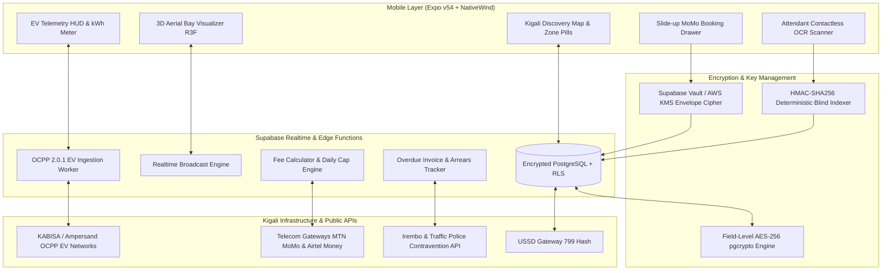

# ParkZone: Master Architecture, Security/Encryption, 3D Visual Engine & System Specification

> **Platform**: Smart Urban Parking, Real-Time EV Telemetry, Municipal Enforcement & Privacy Engine  
> **Target Market**: Kigali, Rwanda (Nyarugenge CBD, CHIC, Kigali Heights, KCC, Kimihurura, Remera)  
> **Regulatory Compliance**: Rwanda Data Protection & Privacy Law (Law Nº 058/2021 administered by NCSA)  
> **Client Framework**: React Native (Expo v54) with NativeWind / Tailwind CSS & Three.js / React Three Fiber  
> **Backend & Realtime Engine**: Supabase (PostgreSQL 16, pg_crypto, Row Level Security, KMS/Vault Key Management)  
> **Visual Aesthetic**: High-Contrast Swiss Monochrome with Acid-Lime (`#CCFF00` / `#22C55E`) Semantic Highlights  

---

## 1. Executive Summary & Vision

**ParkZone** is an integrated smart parking, EV energy telemetry, and roadside compliance platform engineered specifically for Kigali's topography and traffic infrastructure. It bridges four interconnected user ecosystems while enforcing **strict military-grade cryptographic protection** across all citizen and vehicle identifying metadata:

1. **Everyday Kigali Drivers**: Eliminates cruising for parking through real-time spot discovery, aerial 3D spatial occupancy views, guaranteed 15-minute arrival reservations, transparent session tracking, and an automated daily commuter tariff cap (2,000 RWF). All Personal Identifiable Information (PII) is encrypted at rest and in transit.
2. **Electric Vehicle (EV) Operators**: Replaces static, inaccurate Google Maps data with active OCPP 2.0.1 telemetry—displaying real-time connector power draws, live queue wait times, and unified charging-plus-parking billing via MTN Mobile Money and Airtel Money.
3. **On-the-Ground Parking Attendants & Field Agents (Zero-Contact Operations)**: Equips field marshals with an instant, non-contact handheld auditing tool. Marshals never touch vehicles; they use sub-300 ms optical character recognition (OCR) that queries cryptographically hashed plates to inspect paid vs. unpaid sessions, issue digital 3,000 RWF citations exclusively to cars parked without using the app, and audit/flag overdue vehicle invoices for municipal collection. Marshals can never see driver phone numbers, names, or historical itineraries.
4. **Municipal Enforcement & City Authorities**: Automates contravention records and arrears tracking linked directly to the national Irembo platform, replacing physical roadside friction and unauthorized clamping disputes with verifiable digital audit trails.

---

## 2. End-to-End Encryption & Citizen Data Privacy (Law Nº 058/2021)

To strictly comply with Rwanda's Law Nº 058/2021 relating to the Protection of Personal Data and Privacy (monitored by the National Cyber Security Authority - NCSA), ParkZone enforces a **Defense-in-Depth Cryptographic Architecture**.

```
┌─────────────────────────────────────────────────────────────────────────────────┐
│              PARKZONE DATA ENCRYPTION & PRIVACY ARCHITECTURE                     │
└─────────────────────────────────────────────────────────────────────────────────┘
                                       │
     ┌─────────────────────────────────┴─────────────────────────────────┐
     ▼                                                                   ▼
[ CLIENT-SIDE & IN-TRANSIT ]                            [ POSTGRESQL & AT-REST STORAGE ]
• TLS 1.3 Strict Transport Security                     • Transparent Data Encryption (TDE AES-256)
• Deterministic Plate Hashing (HMAC-SHA256)              • Application Column-Level Encryption (pgcrypto)
• Zero PII Exposed to Marshals (Pseudonymization)        • Supabase Vault / AWS KMS Master Key Wrap
• Ephemeral Session Tokens (JWT + RLS)                  • Field Masking for Agent OCR APIs
```

### 2.1 Cryptographic Strategy: Hashing vs. Column-Level Encryption

Relational queries (such as looking up if plate `RAD 450 A` has paid) require indexed searches, while storage of raw plate numbers, phone numbers, and names must remain unreadable even if the physical database is breached:

1. **Deterministic Blind Indexing (`plate_hash` & `phone_hash`)**:
   - Uses **HMAC-SHA-256** keyed with an isolated master secret stored in Supabase Vault / AWS KMS:
     $$\text{plate\_hash} = \text{HMAC-SHA256}(K_{\text{index}}, \text{UPPER}(\text{TRIM}(\text{plate\_number})))$$
   - Allows $O(1)$ fast indexed lookups by agents and automated cameras without storing or exposing plaintext plate numbers in the searchable column index.
2. **Symmetric Column-Level Cipher (`pgcrypto` AES-256-GCM)**:
   - Sensitive fields (`full_name`, `phone_number`, `plate_number`, `make_model`) are encrypted before writing to disk using authenticated envelope encryption ($K_{\text{data}}$).
   - Keys are managed externally via Supabase Vault and never hardcoded in SQL or client code.
3. **Zero-PII Exposure for Marshals (Data Minimization)**:
   - Handheld marshals scanning license plates query via the `verify_plate_status(plate_input)` secure stored procedure.
   - The query response returns *only*: `status` (`paid | overdue | unregistered`), `time_remaining`, `overdue_amount`, and a randomized vehicle session token. **Driver names, phone numbers, and past visit logs are strictly scrubbed and withheld from field personnel.**

---

## 3. Field Agent Workflow & Zero-Contact Protocol

```
┌─────────────────────────────────────────────────────────────────────────────────┐
│                    ZERO-CONTACT FIELD AGENT AUDIT WORKFLOW                      │
└─────────────────────────────────────────────────────────────────────────────────┘
                                       │
                         [ Point Handheld Camera (OCR) ]
                                       │
                                       ▼
                     [ Plate Recognition: e.g. "RAD 450 A" ]
                                       │
                                       ▼
                     [ Hash Plate: HMAC-SHA256(Secret, Plate) ]
                                       │
             ┌─────────────────────────┼─────────────────────────┐
             │                         │                         │
             ▼                         ▼                         ▼
     [ 1. PAID SESSION ]     [ 2. OVERDUE INVOICE ]    [ 3. UNREGISTERED CAR ]
     • Green Glow Status     • Amber Alert             • Red Citation Trigger
     • Remaining: 42 mins    • Elapsed: +35 mins       • Zero app check-in
     • Action: NONE          • Action: FLAG INVOICE    • Action: ISSUE 3,000 RWF
     • (Hands off car)       • (Flagged in Cloud)      • (Digital citation only)
```

### 3.1 Strict Zero-Contact Mandate ("Hands-Off" Protocol)
* **No Physical Contact**: Field attendants are strictly prohibited from touching, leaning on, placing physical paper tickets under wipers, or affixing mechanical wheel clamps onto vehicles.
* **100% Contactless Auditing**: All verifications are performed optically from a 1.5–3 meter distance using the handheld terminal or smartphone camera.
* **Evidence-Backed Citations**: When issuing a digital citation, the agent captures a single wide-angle photo of the vehicle within the marked bay. The image is encrypted and stored with an ephemeral signed URL in Supabase Storage.

### 3.2 Four-Tier Diagnostic States

| Vehicle State | Terminal Display | Visual Indicator | Permitted Agent Action |
| :--- | :--- | :--- | :--- |
| **Active & Paid** | `PAID - 1h 14m Left` | Emerald Green Border | None. Vehicle is fully authorized. |
| **Arrival Grace Period** | `GRACE BUFFER - 7m Left` | Sky Blue Pill | None. Driver has up to 15 mins to check in upon parking. |
| **Overdue Session** | `OVERDUE - 45m Past Due` | Amber / Orange Warning | **Flag Invoice**: Agent marks overdue balance in system; pushes SMS reminder & queues for municipal tax sync. **Zero physical contact.** |
| **Unregistered Vehicle** | `NO ACTIVE RECORD` | Crimson Red Alert | **Issue Citation**: Agent triggers a **3,000 RWF Fine** with one tap. Citations push directly to Irembo and driver SMS. |

### 3.3 Overdue Invoice Tracking & Escalation Flagging
When a driver starts a session but overstays their prepaid window:
1. **Automated Arrears Calculation**: The system applies the formula $\min(300 \times \lceil\text{hours}\rceil, 2000)$ and marks the ticket as `overdue`.
2. **Handheld Audit Flagging**: When a marshal scans an overdue plate, the app displays historical unpaid tickets and total outstanding arrears (e.g., *"Vehicle has 2 overdue invoices: 1,800 RWF"*), with identity information masked.
3. **One-Tap Flagging (`flag_overdue`)**:
   - Does not touch or immobilize the vehicle on the street.
   - Dispatches an asynchronous push prompt to the owner's MTN MoMo account.
   - Flags the hashed vehicle index in the municipal central registry so that barrier lots (Kigali Heights, CHIC, KCC) require settlement of prior arrears before exit gate opening.
   - If cumulative overdue balances exceed 10,000 RWF, the plate hash is sent to the Traffic Police / Irembo registry for compliance holds during annual motor vehicle inspection (Contrôle Technique).

---

## 4. UI/UX Design System (Reference-Inspired Refinement)

ParkZone pairs an ultra-clean, high-contrast dark aesthetic with tactile visual elements adapted from modern high-density urban parking applications.

```
┌─────────────────────────────────────────────────────────────────────────────┐
│ 1. Header Zone Switcher              2. Aerial Visual Bay Grid              │
│    [All Zones] [Zone A] [Zone B]        ┌──────────────┐  ┌──────────────┐  │
│                                         │ Bay #101     │  │  [3D CAR]    │  │
│ 3. Interactive Topology Mode            │  Available   │  │   Occupied   │  │
│    [45 Oblique] [90 Mall] [Parallel]    ├──────────────┤  ├──────────────┤  │
│                                         │  [3D CAR]    │  │ Bay #104     │  │
│ 4. Floating HUD / Drawer                │   Occupied   │  │  [SELECTED]  │  │
│    KN 4 Ave • Downtown Kigali           └──────────────┘  └──────────────┘  │
│    Slot 104 • 300 RWF/hr                ──────────────────────────────────  │
│    [ Pay with MTN MoMo 25078... ]       [ Reserve Bay #104 (300 RWF)  -> ]   │
└─────────────────────────────────────────────────────────────────────────────┘
```

### 4.1 Color Palette & Visual Hierarchy
* **Deep Pitch Black (Canvas)**: `#000000`
* **Card & Surface Elevate**: `#0F0F0F` / `#161616`
* **Borders & Dividers**: `#262626` / `#333333`
* **Primary Contrast Fill**: `#FFFFFF`
* **Sub-text & Metadata**: Neutral Slate `#888888`
* **Active Accent (Action & Availability)**: Acid-Lime (`#CCFF00`)
* **Occupied / Citation Alert**: Crimson Red (`#EF4444`)
* **Overdue Warning**: Amber (`#F59E0B`)
* **EV Dynamic Accent**: Emerald Green (`#22C55E`)

### 4.2 Key Screen Patterns
* **Zone Selection Chips**: Top horizontal pill bar (`Zone A - Ground`, `Zone B - Mezzanine`, `Zone C - Rooftop`, `EV Fast Hub`).
* **Tactile Aerial Bay Selector**: Bays render real-time availability. Vacant slots glow with an acid-lime outline; occupied slots feature procedural 3D aerial vehicles.
* **Persistent Bottom Drawer / Floating Pill Dock**: Floats above navigation maps without occluding street details, showing selected bay details, hourly rate, masked vehicle plate, and one-tap checkout.
* **Agent Quick-Inspect HUD**: Camera viewfinder with plate bounding box and real-time color badge: `Green` (Paid), `Amber` (Overdue), `Red` (Unregistered).

---

## 5. 3D Aerial Parking Visualization Engine

Instead of generic 2D grids, ParkZone uses an aerial top-down 3D engine built on `@react-three/fiber/native` and `three.js`. The camera maintains an aerial orthographic tilt ($FOV \approx 40^\circ - 45^\circ$, elevation $Y = 16$), providing an unmistakable birds-eye representation of lot geometry.

### 5.1 Procedural 3D Aerial Vehicles
Occupied stalls procedurally render cars directly from code (avoiding heavy external 3D asset downloads on mobile networks):
* **Drop Shadow**: Soft radial base projection on asphalt.
* **Body Chassis**: Beveled low-profile box with metallic/roughness reflection.
* **Aerodynamic Glass Greenhouse**: High-contrast tinted canopy.
* **Lighting Details**: Micro headlights (warm yellow), tail-lights (crimson red), and an optional EV solar roof badge (green).

### 5.2 The Three Kigali Parking Topologies
1. **Oblique Parking ($45^\circ$ Diagonal Angle)**:
   * **Kigali Context**: Standard along downtown avenues such as KN 4 Ave (Nyarugenge CBD) and boulevard side stalls.
   * **Transformation**: Stalls rotated $\theta = -\frac{\pi}{4}$ and $\theta = \frac{3\pi}{4}$ with alternating shear offsets ($x_{\text{skew}} = \text{index} \times 0.5$).
2. **Perpendicular Parking ($90^\circ$ Right-Angle)**:
   * **Kigali Context**: Commercial garages including Kigali Heights (Basements P1/P2), CHIC Complex, Kigali Convention Centre, and BK Arena.
   * **Transformation**: Stalls rotated $\theta = 0$ or $\theta = \pi$ with a $6.0\text{ m}$ central driving aisle.
3. **Parallel Parking ($0^\circ$ In-Line Tandem)**:
   * **Kigali Context**: Single-lane street edges such as Kimihurura (KG 674 St) and residential dining corridors in Kiyovu.
   * **Transformation**: Stalls rotated $\theta = \frac{\pi}{2}$, stall length expanded to $5.2\text{ m}$.

---

## 6. Active EV Telemetry Engine (Outperforming Google Maps)

Static map apps like Google Maps display only static metadata. ParkZone integrates live OCPP 2.0.1 telemetry:

| Feature | Google Maps | ParkZone EV Telemetry |
| :--- | :--- | :--- |
| **Charger Status** | Static label ("Open 24 hrs") | **Real-Time Live Stream** (`Available`, `In-Use`, `Faulted`) |
| **Power Output & Protocol** | Crowdsourced text | **Live kW Output** (60 kW CCS2 vs. 22 kW Type 2) |
| **Queue & Wait Estimation** | None | **Live Battery Curve Predictor** ("Next plug in $\approx 14$ mins") |
| **Billing Integration** | None (separate third-party apps) | **Unified Payment** (Parking + Electricity in 1 MoMo prompt) |
| **Pre-Arrival Reservation** | Not supported | **15-Minute Charger Bay Hold** |
| **E-Moto Battery Swap Nodes** | Missing / scattered | **Live Battery Inventory** (Ampersand / Spiro stock counts) |

---

## 7. Driver Incentive Matrix & Kigali Mobility Flywheel

1. **Anti-Clamping Protection Shield**: Eliminates $25,000 - 50,000\text{ RWF}$ roadside towing and immobilization disputes. Checking in logs the hashed plate into the live enforcement database with a 15-minute grace window.
2. **Commuter Daily Cap ($2,000\text{ RWF}$)**: Drivers moving between meetings in Nyarugenge, Kimihurura, and Kacyiru enjoy an automated ceiling:
   $$\text{Total Fee} = \min\big(\max(1, \lceil\text{hours}\rceil) \times 300,\; 2000\big)\text{ RWF}$$
3. **Official RRA-EBM Tax Receipts**: Cryptographically signed electronic receipts for corporate expense claims.
4. **Spot Reservation Lock**: For a $100\text{ RWF}$ deposit, high-traffic lots hold a bay for 15 minutes prior to arrival.

---

## 8. Smart City Infrastructure & Kigali Operational Features

* **USSD Fallback Gateway (`*182#` & `*799#`)**: Supports offline transactions and feature phones via `*799*SPOT_NUMBER*PLATE#`.
* **Attendant Optical Character Recognition (OCR)**: Sub-300 ms on-device plate reading via ML Kit, querying HMAC blind indexes to preserve privacy.
* **Irembo & Municipal Contravention Gateway**: Citations synchronize directly to Irembo contravention registers for official settlement.

---

## 9. Encrypted Database Architecture & Security Schema

### 9.1 Database Security Architecture & Schema Definition

```sql
-- Enable pgcrypto extension for field-level encryption
CREATE EXTENSION IF NOT EXISTS "pgcrypto";

-- ============================================================================
-- 1. ENCRYPTED PROFILES TABLE
-- ============================================================================
CREATE TABLE public.profiles (
    id UUID PRIMARY KEY REFERENCES auth.users(id) ON DELETE CASCADE,
    -- Blind index hash for exact lookups (phone & email)
    phone_hash VARCHAR(64) NOT NULL UNIQUE,
    email_hash VARCHAR(64) NOT NULL UNIQUE,
    -- AES-256 encrypted ciphertext fields
    encrypted_full_name BYTEA NOT NULL,
    encrypted_phone_number BYTEA NOT NULL,
    encrypted_email BYTEA NOT NULL,
    role VARCHAR(20) DEFAULT 'driver' CHECK (role IN ('driver', 'agent', 'admin')),
    created_at TIMESTAMPTZ DEFAULT NOW(),
    updated_at TIMESTAMPTZ DEFAULT NOW()
);

-- ============================================================================
-- 2. ENCRYPTED VEHICLES TABLE
-- ============================================================================
CREATE TABLE public.vehicles (
    id UUID PRIMARY KEY DEFAULT gen_random_uuid(),
    user_id UUID REFERENCES public.profiles(id) ON DELETE CASCADE,
    -- HMAC-SHA256 blind index for O(1) searches without plaintext exposure
    plate_hash VARCHAR(64) NOT NULL UNIQUE,
    -- Masked plate for secure agent & UI display (e.g., "RAD *** A")
    masked_plate VARCHAR(16) NOT NULL,
    -- AES-256 encrypted raw vehicle metadata
    encrypted_plate_number BYTEA NOT NULL,
    encrypted_make_model BYTEA,
    encrypted_color BYTEA,
    vehicle_type VARCHAR(20) DEFAULT 'gasoline' CHECK (vehicle_type IN ('gasoline', 'ev', 'handicap')),
    is_default BOOLEAN DEFAULT false,
    has_unpaid_arrears BOOLEAN DEFAULT false,
    total_arrears_rwf NUMERIC DEFAULT 0.00,
    created_at TIMESTAMPTZ DEFAULT NOW()
);

-- Index for instant sub-millisecond plate verification
CREATE INDEX idx_vehicles_plate_hash ON public.vehicles(plate_hash);

-- ============================================================================
-- 3. PARKING LOCATIONS & SPACES
-- ============================================================================
CREATE TABLE public.parking_locations (
    id UUID PRIMARY KEY DEFAULT gen_random_uuid(),
    name VARCHAR(120) NOT NULL,
    address VARCHAR(255) NOT NULL,
    city VARCHAR(64) DEFAULT 'Kigali',
    latitude NUMERIC(10, 7) NOT NULL,
    longitude NUMERIC(10, 7) NOT NULL,
    layout_topology VARCHAR(32) DEFAULT 'oblique' CHECK (layout_topology IN ('oblique', 'perpendicular', 'parallel')),
    hourly_rate NUMERIC DEFAULT 300.00,
    daily_rate NUMERIC DEFAULT 2000.00,
    is_active BOOLEAN DEFAULT true,
    created_at TIMESTAMPTZ DEFAULT NOW()
);

CREATE TABLE public.parking_spaces (
    id UUID PRIMARY KEY DEFAULT gen_random_uuid(),
    location_id UUID REFERENCES public.parking_locations(id) ON DELETE CASCADE,
    space_number VARCHAR(16) NOT NULL,
    space_type VARCHAR(20) DEFAULT 'regular' CHECK (space_type IN ('regular', 'ev', 'handicap')),
    zone_code VARCHAR(16) DEFAULT 'Zone A',
    is_occupied BOOLEAN DEFAULT false,
    -- Only stores the blind hash of the parked plate; never plaintext
    current_plate_hash VARCHAR(64),
    current_vehicle_id UUID REFERENCES public.vehicles(id),
    qr_code_token VARCHAR(64) UNIQUE NOT NULL,
    camera_device_id VARCHAR(64)
);

CREATE INDEX idx_parking_spaces_location_zone ON public.parking_spaces(location_id, zone_code);

-- ============================================================================
-- 4. EV CHARGING TELEMETRY
-- ============================================================================
CREATE TABLE public.ev_charging_points (
    id UUID PRIMARY KEY DEFAULT gen_random_uuid(),
    location_id UUID REFERENCES public.parking_locations(id) ON DELETE CASCADE,
    station_identifier VARCHAR(64) NOT NULL,
    connector_type VARCHAR(32) NOT NULL,
    max_output_kw NUMERIC NOT NULL,
    price_per_kwh NUMERIC NOT NULL,
    status VARCHAR(32) DEFAULT 'available' CHECK (status IN ('available', 'charging', 'faulted', 'reserved')),
    current_power_draw_kw NUMERIC DEFAULT 0.0,
    estimated_free_at TIMESTAMPTZ,
    last_heartbeat TIMESTAMPTZ DEFAULT NOW()
);

-- ============================================================================
-- 5. PARKING TICKETS & ENCRYPTED EVIDENCE FINES
-- ============================================================================
CREATE TABLE public.parking_tickets (
    id UUID PRIMARY KEY DEFAULT gen_random_uuid(),
    ticket_number VARCHAR(32) UNIQUE NOT NULL,
    user_id UUID REFERENCES public.profiles(id),
    vehicle_id UUID REFERENCES public.vehicles(id),
    plate_hash VARCHAR(64) NOT NULL,
    location_id UUID REFERENCES public.parking_locations(id),
    space_id UUID REFERENCES public.parking_spaces(id),
    entry_time TIMESTAMPTZ DEFAULT NOW(),
    exit_time TIMESTAMPTZ,
    hourly_rate NUMERIC DEFAULT 300.00,
    daily_cap NUMERIC DEFAULT 2000.00,
    total_amount NUMERIC DEFAULT 300.00,
    status VARCHAR(20) DEFAULT 'active' CHECK (status IN ('active', 'completed', 'overdue', 'cancelled')),
    payment_status VARCHAR(20) DEFAULT 'unpaid' CHECK (payment_status IN ('unpaid', 'paid')),
    payment_method VARCHAR(20) DEFAULT 'momo',
    is_flagged_by_agent BOOLEAN DEFAULT false,
    created_at TIMESTAMPTZ DEFAULT NOW()
);

CREATE TABLE public.parking_fines (
    id UUID PRIMARY KEY DEFAULT gen_random_uuid(),
    fine_number VARCHAR(32) UNIQUE NOT NULL,
    vehicle_id UUID REFERENCES public.vehicles(id),
    plate_hash VARCHAR(64) NOT NULL,
    location_id UUID REFERENCES public.parking_locations(id),
    space_id UUID REFERENCES public.parking_spaces(id),
    fine_amount NUMERIC DEFAULT 3000.00,
    reason VARCHAR(64) DEFAULT 'unregistered_parking',
    issued_by UUID REFERENCES public.profiles(id),
    payment_status VARCHAR(20) DEFAULT 'unpaid',
    irembo_reference_code VARCHAR(64),
    -- Encrypted storage reference for citation evidence photo
    evidence_photo_url TEXT,
    created_at TIMESTAMPTZ DEFAULT NOW()
);

CREATE TABLE public.vehicle_invoice_flags (
    id UUID PRIMARY KEY DEFAULT gen_random_uuid(),
    ticket_id UUID REFERENCES public.parking_tickets(id) ON DELETE CASCADE,
    plate_hash VARCHAR(64) NOT NULL,
    flagged_by_agent_id UUID REFERENCES public.profiles(id),
    flagged_at TIMESTAMPTZ DEFAULT NOW(),
    overdue_amount_rwf NUMERIC NOT NULL,
    notification_status VARCHAR(20) DEFAULT 'pending',
    resolution_status VARCHAR(20) DEFAULT 'open'
);

-- ============================================================================
-- 6. ROW LEVEL SECURITY (RLS) POLICIES
-- ============================================================================
ALTER TABLE public.profiles ENABLE ROW LEVEL SECURITY;
ALTER TABLE public.vehicles ENABLE ROW LEVEL SECURITY;
ALTER TABLE public.parking_tickets ENABLE ROW LEVEL SECURITY;
ALTER TABLE public.parking_fines ENABLE ROW LEVEL SECURITY;
ALTER TABLE public.vehicle_invoice_flags ENABLE ROW LEVEL SECURITY;

-- Profiles: Users can only read & update their own record; Agents cannot view user PII
CREATE POLICY "Users read own profile" ON public.profiles
    FOR SELECT USING (auth.uid() = id);

CREATE POLICY "Users update own profile" ON public.profiles
    FOR UPDATE USING (auth.uid() = id);

-- Vehicles: Users manage their own vehicles; Agents only query via secure procedures
CREATE POLICY "Users manage own vehicles" ON public.vehicles
    FOR ALL USING (auth.uid() = user_id);

-- Tickets: Drivers view only their own tickets; Agents access only via plate verification RPC
CREATE POLICY "Drivers view own tickets" ON public.parking_tickets
    FOR SELECT USING (auth.uid() = user_id);

-- ============================================================================
-- 7. ZERO-CONTACT AGENT AUDIT RPC (Zero PII Exposure)
-- ============================================================================
CREATE OR REPLACE FUNCTION public.verify_plate_status(p_plate_hash VARCHAR)
RETURNS JSONB
LANGUAGE plpgsql
SECURITY DEFINER
SET search_path = public
AS $$
DECLARE
    v_ticket RECORD;
    v_vehicle RECORD;
    v_response JSONB;
BEGIN
    -- Check for an active ticket using the blind plate hash
    SELECT * INTO v_ticket
    FROM public.parking_tickets
    WHERE plate_hash = p_plate_hash AND status IN ('active', 'overdue')
    ORDER BY entry_time DESC
    LIMIT 1;

    -- Query vehicle arrears
    SELECT * INTO v_vehicle
    FROM public.vehicles
    WHERE plate_hash = p_plate_hash;

    IF v_ticket IS NOT NULL THEN
        IF v_ticket.status = 'active' THEN
            v_response := jsonb_build_object(
                'status', 'PAID',
                'ticket_id', v_ticket.id,
                'entry_time', v_ticket.entry_time,
                'has_arrears', COALESCE(v_vehicle.has_unpaid_arrears, false),
                'arrears_amount', COALESCE(v_vehicle.total_arrears_rwf, 0.00)
            );
        ELSE
            v_response := jsonb_build_object(
                'status', 'OVERDUE',
                'ticket_id', v_ticket.id,
                'entry_time', v_ticket.entry_time,
                'overdue_amount', v_ticket.total_amount,
                'has_arrears', true,
                'arrears_amount', COALESCE(v_vehicle.total_arrears_rwf, 0.00)
            );
        END IF;
    ELSE
        v_response := jsonb_build_object(
            'status', 'UNREGISTERED',
            'has_arrears', COALESCE(v_vehicle.has_unpaid_arrears, false),
            'arrears_amount', COALESCE(v_vehicle.total_arrears_rwf, 0.00)
        );
    END IF;

    RETURN v_response;
END;
$$;
```

---

## 10. Comprehensive System Architecture Diagram



---

## 11. Phased Implementation Roadmap

1. **Phase 1: Cryptographic Migration & Zero-Knowledge Schema (Week 1)**
   * Deploy `pgcrypto` extension and Vault key rotation scripts.
   * Migrate `profiles` and `vehicles` to encrypted bytea storage and `HMAC-SHA256` blind search indexes.
   * Implement `verify_plate_status` RPC to sanitize PII before returning data to field attendants.

2. **Phase 2: Visual Engine & Topologies (Weeks 2–3)**
   * Deploy `components/AerialParkingLot3D.tsx` into the main lot details sheet.
   * Connect zone switcher pills (`Zone A`, `Zone B`, `Zone C`) to filter database spaces.
   * Verify 60 FPS rendering performance on mid-range devices.

3. **Phase 3: EV Telemetry & Live Pricing (Weeks 4–5)**
   * Run migration for `ev_charging_points`.
   * Implement real-time subscriptions for EV charger state (`available`, `charging`).
   * Finalize unified MoMo checkout for combined parking + charging sessions.

4. **Phase 4: Field Enforcement, Zero-Contact OCR & Overdue Flagging (Weeks 6–7)**
   * Deploy ML Kit camera OCR on the Attendant Portal tab for contactless plate scanning.
   * Implement status triage: `Paid` (Green), `Overdue` (Amber flag), `Unregistered` (3,000 RWF fine).
   * Integrate digital citation photographic evidence upload to Supabase Storage with encrypted access tokens.
   * Connect overdue ticket flagging to automated SMS MoMo reminder triggers and Irembo contravention references.

5. **Phase 5: Kigali Pilot Rollout (Weeks 8–9)**
   * Seed pilot lots across three distinct topologies:
     * **Oblique**: KN 4 Ave (Nyarugenge CBD)
     * **Perpendicular**: Kigali Heights (KH Basement & Surface)
     * **Parallel**: Kimihurura Gastronomy Corridor (KG 674 St)